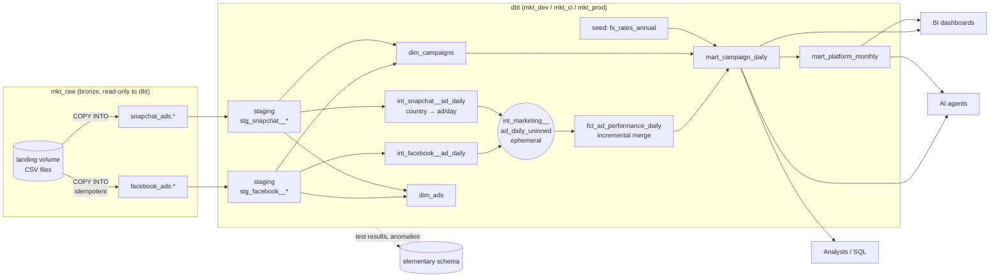
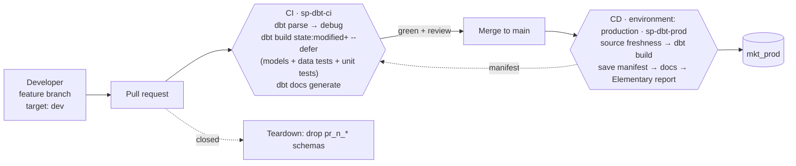

# Marketing Data Platform: Databricks + dbt

A governed, tested and documented **unified marketing data product** for Facebook Ads and
Snapchat Ads. Analysts, BI tools and AI agents can answer *"How much did we spend on
Facebook last month?"* without opening either ad platform, and get the **right** answer.

> **Reading guide.** Section 2 (*What the data actually looks like*) drives every design
> decision after it. If you read one section, read that one.

---

## 1. Architecture



| Layer | Where | What it guarantees |
|---|---|---|
| **Raw / bronze** | `mkt_raw.facebook_ads.*`, `mkt_raw.snapchat_ads.*` | Exact copy of the source files, all `STRING`, plus `_source_file` and `_ingested_at` audit columns. Nobody running dbt can write here. |
| **Staging** | `<env>.staging` | One model per source table: renamed, typed, `"null"` text → `NULL`, deduplicated (latest version wins). No joins, no business logic. |
| **Intermediate** | `<env>.intermediate` | Platform normalisation: both platforms reshaped to the same contract at ad × day. |
| **Marts** | `<env>.marts` | The **consumption layer**: an atomic fact, two dimensions and two ready-to-query marts. **The only schema analysts and agents can read.** |

---

## 2. What the data actually looks like (profiling before modelling)

I profiled every file before writing a model. Several findings would have silently
produced wrong numbers:

| # | Finding | Evidence | Consequence if ignored | Handled in |
|---|---|---|---|---|
| 1 | **Facebook spends in two currencies** | 1 account (66k rows, $6.87M) bills in **USD**, the rest in **EUR** | `SUM(spend)` mixes dollars and euros. Facebook spend overstated by **€790k (9%)** | `spend_eur` via `fx_rates_annual` seed + test that every row has a rate |
| 2 | **Snapchat stats are per country** | 2,809 rows, only 1,052 distinct ad/day pairs (DE, CH, AT, US) | Grain mismatch with Facebook. Naive ad/day keys are not unique | `int_snapchat__ad_daily` sums countries → ad/day (unit-tested) |
| 3 | **`"null"` as text** | FB clicks `"null"` on 24,337 rows vs explicit `0` on only **42**. FB impressions `"null"` on 1,474 rows, **all with spend = 0** | `CAST` fails, or metrics become NULL and totals drop | `clean_string` macro. The export omits zeros, so additive metrics → 0, with `has_unreported_metrics` audit flag |
| 4 | **Duplicate ad groups (history export)** | Snapchat: 267 rows / 264 ids. Same id, two `updated_at` values | Joining stats → ad groups **double-counts** those ad groups' spend | `qualify row_number()` latest-version dedupe in every staging model |
| 5 | **Platforms don't overlap in time** | Facebook 2025-01-01 → 2025-12-31. Snapchat 2024-01-01 → 2024-12-02 (no Apr, May, Oct) | "Compare FB vs Snapchat last month" returns one side empty, which looks like a bug | Documented in dbt docs overview + agent guidance. Not "fixed", because it's the data |
| 6 | **FB campaigns have no account** | `campaigns` export has no `account_id` | No account or currency at campaign level | Derived via ads in `int_facebook__campaign_accounts`, with a unique test proving 1 campaign → 1 account |
| 7 | **Orphan Snapchat ads** | 304 / 2,513 ads point to ad groups missing from the export. **None of them have spend** | Inner joins would drop spend if one starts spending | LEFT joins everywhere + `not_null(campaign_key)` on the fact (error) + reconciliation test |
| 8 | Snapchat spend units | Values like `48.174024` | The Snapchat API reports **micro-currency**, but this export is already in real units | Range test (`spend ≤ 100,000` per ad/country/day) guards against a future micro-currency file |
| 9 | IDs look numeric | FB ids are 18-digit numbers, Snapchat ids are UUIDs | Casting to BIGINT is fragile and blocks a common key type | All ids stay `STRING`. Surrogate keys include `platform` |

---

## 3. Data model

### 3.1 Grain of every model (no ambiguity)

| Model | Grain: one row per… | Primary key |
|---|---|---|
| `stg_facebook__ad_stats` | Facebook ad × day | (`ad_id`, `date_day`) |
| `stg_snapchat__ad_stats` | Snapchat ad × day × **country** | (`ad_id`, `date_day`, `country_code`) |
| `int_facebook__ad_daily`, `int_snapchat__ad_daily` | ad × day | (`ad_id`, `date_day`) |
| **`fct_ad_performance_daily`** | **platform × ad × day** | `ad_performance_key` = hash(platform, ad_id, date_day) |
| `dim_campaigns` | platform × campaign | `campaign_key` = hash(platform, campaign_id) |
| `dim_ads` | platform × ad | `ad_key` = hash(platform, ad_id) |
| **`mart_campaign_daily`** | platform × campaign × day | (`campaign_key`, `date_day`) |
| **`mart_platform_monthly`** | platform × month | (`platform`, `month_start`) |

### 3.2 Key decisions, and the argument against each

**Fact grain = ad × day, not campaign × day (the brief's example).**
Ad × day is the lowest grain *both* platforms share. Snapchat has country, Facebook doesn't.
Campaign × day, platform × month and the rest are exact sums of it. You can't drill from
campaign back down to ad.
*Counter-argument:* "Nobody asked for ad level." True today. Rebuilding the fact later costs
far more than the extra rows (~93k) cost now.

**Star schema + wide marts, not one or the other.**
The fact plus dimensions is the reusable, normalised core (Section 1 problem 4: *poor
reusability*). `mart_campaign_daily` is a wide, pre-joined table for people and agents who
should not have to know how to join. *Counter-argument:* "Two ways to get the same number
can disagree." That's why `assert_mart_reconciles_to_fact` exists.

**Only additive measures in tables. Ratios are computed, never stored row by row.**
CTR, CPC and CPM can't be summed or averaged. On this data, `AVG(ctr)` over campaign-days
overstates CTR by **19% for Facebook (0.751% vs the true 0.634%) and 42% for Snapchat**. An
AI agent asked for "average CTR" will happily write `AVG(ctr)` if such a column exists. So
row-level tables have only `spend`, `impressions` and `clicks`. `mart_platform_monthly`
publishes ratios at **one fixed grain**, computed as ratio-of-sums. Its docs say they can't
be re-aggregated.

**Zero denominators → `NULL`, never `0`.** CPC with 0 clicks is *undefined*, not free. A `0`
would drag averages down and read as "great performance". `safe_divide` macro.

**Spend stays in local currency in the fact. EUR conversion happens in the marts.**
Facts should be immutable observations. FX rates are reference data that get corrected. If
`spend_eur` lived in the incremental fact, correcting a rate would leave old rows stale until
a full refresh. The marts are rebuilt every run, so a seed change is applied everywhere at
once. Column names carry the unit (`spend_eur`, `spend_local`, `local_currency_code`), so
neither a human nor an agent can mistake one for the other.
*Known simplification:* annual ECB average rates (2025 USD = 1.1300 per EUR). Production
should load daily ECB reference rates into bronze. The join is already on a period key, so
only the seed changes.

**Never join on campaign name.** Keys hash `platform` into them, so a Facebook campaign and
a Snapchat campaign can never merge, even if ids or names collide.

**Names live in dimensions, not in the incremental fact.** A campaign renamed on the platform
shows the new name everywhere on the next run, with no backfill (SCD type 1). If "name at
time of spend" is ever needed, the dimension becomes a dbt snapshot (SCD2).

---

## 4. Materializations: why each one

| Model(s) | Materialization | Why |
|---|---|---|
| `stg_*` | **view** | Thin rename/cast layer. Always reflects bronze, no storage cost. Light enough to recompute at this volume. |
| `int_facebook__ad_daily`, `int_snapchat__ad_daily`, `int_facebook__campaign_accounts` | **view** | Reusable logic that must stay **queryable** for debugging and for unit tests. |
| `int_marketing__ad_daily_unioned` | **ephemeral** | A pure `UNION ALL` + key hashing with **one consumer**. Persisting it would store a full copy of the data for no reader. |
| `fct_ad_performance_daily` | **incremental**, `merge` on `ad_performance_key` | See below. |
| `dim_campaigns`, `dim_ads`, `mart_campaign_daily` | **table** | Read constantly by BI and agents. Compute once per run, not on every dashboard refresh. Rebuilt fully, so renames and FX corrections always apply. |
| `mart_platform_monthly` | **view** | ~20 rows aggregated from a table. Always consistent with `mart_campaign_daily`, nothing to store. |
| `fx_rates_annual` | **seed** | Small, slow-changing reference data that must be **version-controlled and reviewed**. |

### Why the fact is incremental, and why this way

Ad platforms **restate** recent days as attribution windows close. A row for 3 March can
change on 5 March.

- **`merge`, not `append`.** A restated row must *replace* the old version. Append would
  duplicate spend.
- **Watermark on ingestion time (`_source_ingested_at`), not on event date.** The common
  pattern, "reprocess the last 3 days of `date_day`", misses a restatement of an older date
  and needs a magic number. Filtering on *when the row arrived* picks up any restated row,
  whatever its date. A small overlap (`incremental_overlap_hours`) re-merges a safety window,
  which is harmless because merge is idempotent.
- **Snapchat partial restatements are safe.** If only CH is re-sent for an ad/day, the
  intermediate model re-sums *all* countries for that ad/day before the merge, so the fact
  never ends up holding just the CH number.
- **Verified locally.** I re-sent one Facebook row (+100 spend), one Snapchat CH-only row and
  one brand-new day, then ran incrementally. Facebook went 7.85 → 107.85 (replaced, not
  duplicated). The Snapchat ad/day went 13.84 → 63.84 with all 3 countries. One new row was
  added. All reconciliation tests passed.
- **Honest note:** at ~93k rows a plain table rebuilds in seconds. The incremental design is
  for daily production loads over years of history, and for correct restatement handling.
- **Known limitation:** rows *deleted* at the source are not deleted. Schedule a weekly
  `dbt build -s fct_ad_performance_daily --full-refresh`.

Databricks specifics: Delta + **liquid clustering** on (`date_day`, `platform`), matching the
most common filters. **Model contracts are enforced** on the fact and on
`mart_campaign_daily`, so downstream consumers get a guaranteed schema and types. A change
that breaks the interface fails the build instead of breaking a dashboard.

---

## 5. Data quality

Tests protect the numbers, not a checklist. Each category exists because of a specific
failure it would catch:

| Test | On | Catches |
|---|---|---|
| **Reconciliation** `assert_fact_reconciles_to_staging` | spend, impressions, clicks per platform: staging vs fact | Fan-out from duplicate dimension rows, rows dropped by joins, broken incremental filters. **The single most valuable test.** |
| `assert_mart_reconciles_to_fact` | fact vs `mart_campaign_daily` | Duplication introduced by the dimension join in the consumption layer |
| `assert_all_spend_converted_to_eur` | fact × fx rates | A missing FX rate doesn't error. It makes `spend_eur` NULL, and `SUM` silently skips NULLs, so EUR totals would just be *low*. This turns that into a failed build. |
| Grain: `unique` / `unique_combination_of_columns` | every model at its declared grain | Duplicates. On `int_snapchat__ad_daily` it also proves **one currency per ad/day** (currency is in the GROUP BY) |
| `not_null` + `relationships` | keys and FKs | Orphan facts. `not_null(campaign_key)` on the fact is an **error**, because unattributed spend breaks every "by campaign" answer |
| `accepted_values` | `platform` ∈ {facebook, snapchat}, `ad_status` | New / misspelled platform labels, new statuses (warn) |
| `accepted_range` | spend, impressions, clicks ≥ 0. Snapchat spend ≤ 100k. `0 ≤ ctr ≤ 1` | Sign errors, **micro-currency files**, impossible ratios |
| `clicks <= impressions` (warn) | staging + fact | Column swaps in a new export |
| **Unit tests** (dbt 1.8+) | `int_snapchat__ad_daily`, `int_facebook__ad_daily` | The *logic*, on hand-made inputs: country roll-up, `"null"` → 0 with flag, spend survives a missing ad |
| Source freshness | bronze `_ingested_at` (warn 26h / error 72h) | A platform export silently stopping |
| **Elementary** `volume_anomalies`, `schema_changes`, `column_anomalies(sum, null_count)` | sources, fact, `mart_campaign_daily` | Things that pass fixed rules but are *unusual*: a half-sized load, a renamed source column, a sudden drop in spend. `warn` severity, because anomalies need human judgement. |

Severity policy: **error** = numbers would be wrong. **warn** = needs a look but data is still
correct (e.g. the 304 orphan Snapchat ads with no spend).

Local verification result: `PASS=166 WARN=1 ERROR=0`. The one warning is finding #7, by design.

---

## 6. Environments

| | Dev | CI | Prod |
|---|---|---|---|
| Catalog | `mkt_dev` | `mkt_ci` | `mkt_prod` |
| Schemas | `dbt_<you>_staging`, `dbt_<you>_marts`, … | `pr_<n>_staging`, `pr_<n>_marts`, … | `staging`, `intermediate`, `marts`, `elementary` |
| Who runs it | You, from your laptop | GitHub Actions on every PR | GitHub Actions on merge to `main` + daily schedule |
| Identity | Your user | Service principal **`sp-dbt-ci`** | Service principal **`sp-dbt-prod`** |
| Auth | Personal token, laptop only (or browser U2M OAuth) | OAuth M2M | **OAuth M2M, no PAT** |
| Can write to | `mkt_dev` | `mkt_ci` only | 4 pre-created prod schemas only |
| Lifetime | Yours | Dropped when the PR closes | Permanent |

- **Catalog per environment** (not schema per environment): the boundary is a *grant*, not
  a naming convention. CI physically cannot write to prod.
- `generate_schema_name` override: clean names in prod, isolated prefixed schemas everywhere
  else, so two developers or two PRs can never overwrite each other.
- **All environments read the same bronze** (`mkt_raw`), so CI tests run against real data.
- dbt targets differ **only** in `catalog`, `schema` and credentials. The SQL is identical.

## 7. Production authentication

- Prod runs as **service principal `sp-dbt-prod`** with **OAuth machine-to-machine**
  (`auth_type: oauth` + `client_id` + `client_secret` in `profiles.yml`). The Databricks SDK
  mints short-lived tokens. No personal access token exists in the prod path, so production
  keeps working when any individual leaves.
- The SP secret lives only in the GitHub **`production` environment**. Pull-request workflows
  cannot read it. The environment can require manual approval and be locked to `main`.
- CI uses a **separate** SP (`sp-dbt-ci`). A leaked CI secret can't touch production.
- `profiles.yml` is committed **with zero secrets**. Everything is `env_var()`.

## 8. Unity Catalog permissions (`databricks/02_grants.sql`)

| Principal | `mkt_raw` | `mkt_ci` | `mkt_prod` |
|---|---|---|---|
| `sp-dbt-prod` | SELECT | – | USE + CREATE TABLE/MODIFY/SELECT on 4 **pre-created** schemas |
| `sp-dbt-ci` | SELECT | CREATE SCHEMA | SELECT (needed for `--defer`) |
| developer | SELECT | – | SELECT on `marts`, `elementary` |
| `marketing_analysts` (people, BI, AI agents) | – | – | **SELECT on `marts` only** |

**Deliberate deviations from the course example (least privilege):**
- **Removed `CREATE CATALOG ON METASTORE`.** A pipeline identity that can create catalogs can
  build an ungoverned parallel environment. Catalogs are infrastructure, so an admin creates them.
- **No `CREATE SCHEMA` for prod.** The admin pre-creates prod schemas. The SP writes into them
  and nothing else.
- **Schema-scoped grants, not `USE SCHEMA ON CATALOG`.** A catalog-level grant covers every
  current *and future* schema.
- **Grants on schemas, not tables.** dbt drops and recreates tables. Schema grants are inherited
  by new objects, so access never silently disappears after a run.
- **Consumers can't see staging/intermediate.** Those are implementation details. Exposing them
  invites reports on un-deduplicated data, and gives an agent tables it should never use.

## 9. CI/CD



- **Slim CI:** CI downloads the last prod `manifest.json` and builds only *modified models and
  their descendants*. Unchanged upstream models resolve to prod tables (`--defer`). Fast and
  cheap, and it still tests every model the change can affect. Falls back to a full build when
  no prod manifest exists yet.
- `dbt build` (not `run` then `test`): tests run in DAG order, so a failing test **stops
  downstream models from being built on bad data**.
- **Teardown** workflow drops the PR's schemas on close (`drop_ci_schemas` macro, guarded to
  run only on the `ci` target, and matching `pr_7_` so it can never drop `pr_70_*`).
- Docs and the Elementary report are published as **workflow artifacts, not public GitHub
  Pages**. dbt docs expose the whole schema, and Elementary reports can include sample failing
  rows. Neither belongs on a public URL by default.

## 10. Observability: Elementary

The `elementary` dbt package writes run results, test results and anomaly metrics to
`<env>.elementary` on every run. The `edr report` step in CD renders an HTML report covering
**test results over time, failed tests, model run health/duration, source freshness, schema
changes and volume/column anomalies.** Anomaly tests learn a baseline from previous runs, so
they become meaningful after a few production runs (expected, not a bug). Next step: `edr monitor`
to post failures to Slack/Teams.

## 11. Built for AI agents and BI

The brief asks for a *data product*, not a table. For an agent answering in natural language,
that means:

1. **One obvious table.** `mart_campaign_daily` has everything needed (names, platform, month,
   spend in EUR) with no joins. Agents are only granted `marts`.
2. **Units in column names.** `spend_eur` vs `spend_local` + `local_currency_code`. An agent can't
   "accidentally" sum mixed currencies if the safe column is named for it.
3. **Docs travel with the data.** `persist_docs` writes every model and column description into
   Unity Catalog comments, which is where Genie, Catalog Explorer and SQL-connected agents read
   context. The descriptions include the rules: *"Never average CTR"*, *"join on keys, not names"*,
   and data coverage dates.
4. **Ratios that can't be misused.** No row-level ratio columns. Pre-computed ratios only at a
   fixed grain, with docs saying how to re-aggregate.
5. **Lineage to consumers.** Exposures for the dashboard and the AI analyst.
   `dbt ls -s +exposure:marketing_ai_analyst` lists every model an agent's answer depends on.
6. **"Last month" is ambiguous.** The data ends in 2025, so "last month" relative to *today* is
   empty. `analyses/business_questions.sql` shows the agent pattern: resolve it to the latest
   available month and **say which month was used**.

Next step for agents: a Unity Catalog **metric view** (or dbt Semantic Layer) defining `ctr`,
`cpc_eur` and `cpm_eur` once, so every consumer gets the same formula.

## 12. Answers to the business questions (Section 18)

From `analyses/business_questions.sql`, run on the full sample (verified locally, see Section 15):

| Platform | Period | Spend (EUR) | Impressions | Clicks | CTR | CPC (EUR) | CPM (EUR) | Campaigns |
|---|---|---:|---:|---:|---:|---:|---:|---:|
| Facebook | 2025 | **8,641,797.51** | 905,449,421 | 5,737,710 | 0.634% | 1.51 | 9.54 | 77 |
| Snapchat | 2024 (to 2 Dec) | **30,529.54** | 33,395,784 | 19,012 | 0.057% | 1.61 | 0.91 | 9 |
| **Total** | | **8,672,327.06** | | | | | | |

- Facebook spend by billing currency: EUR 2,562,561.24 + USD 6,869,536.99 (= €6,079,236.27). Summing
  local amounts would report 9,432,098.23, which is **€790k too high**.
- Most clicks: *usa_ios_display_ggl_awareness_20230916_interest-stack-v3_video-views* (Facebook, 1,389,414 clicks).
- Highest spend: *gbr_app_influencer_met_retargeting_20230728_lifetime-offer-v2_website-visits* (€1.12M).
- Facebook "last month" (latest month in data, Dec 2025): €679,880.62.
- Snapchat CPM is ~10× cheaper but CTR is ~11× lower. The platforms also ran in different years,
  so this is **not** a like-for-like comparison.

## 13. Setup / runbook

**Prerequisites:** Databricks workspace with Unity Catalog and a SQL warehouse; Databricks CLI ≥ 0.205; Python 3.10+; a GitHub repo.

1. **Create catalogs and schemas:** run `databricks/00_unity_catalog_setup.sql` as admin.
2. **Load raw data:**
   ```bash
   ./databricks/upload_raw_files.sh /path/to/cde_dbt_sample_data
   ```
   then run `databricks/01_bronze_load.sql` (the last query prints expected row counts).
3. **Create two service principals** (Settings → Identity and access → Service principals):
   `sp-dbt-prod` and `sp-dbt-ci`. For each: generate an **OAuth secret**, grant
   *Databricks SQL access*, and give **CAN USE** on the SQL warehouse.
4. **Create the group** `marketing_analysts` (account console), then fill in the placeholders and
   run `databricks/02_grants.sql`.
5. **Local dev:**
   ```bash
   python -m venv .venv && source .venv/bin/activate
   pip install -r requirements.txt
   cp .env.example .env    # fill in host, http_path, token, your name
   set -a; source .env; set +a
   dbt deps && dbt debug && dbt build
   dbt docs generate && dbt docs serve
   ```
6. **GitHub secrets.** Repository secrets: `DATABRICKS_HOST`, `DATABRICKS_HTTP_PATH`,
   `DBX_CI_CLIENT_ID`, `DBX_CI_CLIENT_SECRET`. Create environment **`production`** (restrict to
   `main`, optionally require reviewers) with secrets `DBX_PROD_CLIENT_ID`, `DBX_PROD_CLIENT_SECRET`.
7. **First prod deploy:** push to `main` (or run *CD (production)* manually). This also produces the
   manifest that enables slim CI.
8. **Prove the flow:** open a PR that edits a model and watch CI build into `mkt_ci.pr_<n>_*`.
   Merge it, then watch CD deploy. Close a PR and watch teardown drop its schemas.

## 14. Repository layout

```
├── databricks/                 # infra-as-SQL, run by an admin
│   ├── 00_unity_catalog_setup.sql   catalogs, schemas, landing volume
│   ├── 01_bronze_load.sql           COPY INTO raw tables (+ audit columns)
│   ├── 02_grants.sql                least-privilege grants
│   └── upload_raw_files.sh          CSVs → UC volume
├── models/
│   ├── staging/{facebook,snapchat}/ sources, stg_* models, tests
│   ├── intermediate/                platform normalisation + unit tests
│   └── marts/marketing/             fct, dims, marts, exposures
├── seeds/fx_rates_annual.csv        reviewed reference data
├── tests/                           reconciliation + FX coverage tests
├── macros/                          schema naming, clean_string, safe_divide, CI teardown
├── analyses/business_questions.sql  Section 18 answered in SQL
├── docs/metrics.md                  docs overview + metric definitions
├── .github/workflows/               ci.yml, cd.yml, ci_teardown.yml
├── dbt_project.yml · packages.yml · profiles.yml (no secrets) · requirements.txt
```

## 15. Verification, limitations, next steps

**How this was verified.** The full project was built and tested end to end with dbt 1.12 on
the provided sample data, using a local engine (DuckDB) with an identical bronze layout:
`PASS=166 WARN=1 ERROR=0`, plus the restatement scenario in Section 4 and the CI teardown
macro. The SQL is written to be portable (`dbt.dateadd`, `dbt.date_trunc`, `dbt_utils`
keys, `qualify`). **Not verifiable outside Databricks:** `COPY INTO`, liquid clustering,
OAuth M2M, UC grants, `persist_docs` and contract type checks on Databricks types. These
follow the dbt-databricks documentation and are confirmed by steps 1–8 above.

**Limitations / next steps**
- Daily ECB FX rates instead of annual averages.
- Source deletions are not propagated by the incremental merge (weekly full refresh).
- Account timezone isn't in the exports. `date_day` is assumed to be in each account's reporting timezone.
- Snapchat account names are missing (no account export). Request it from the extractor.
- Country-level Snapchat mart if marketing needs geo analysis (staging keeps the country grain).
- UC metric view / dbt Semantic Layer for single-source metric definitions. `edr monitor` alerts to Slack.
